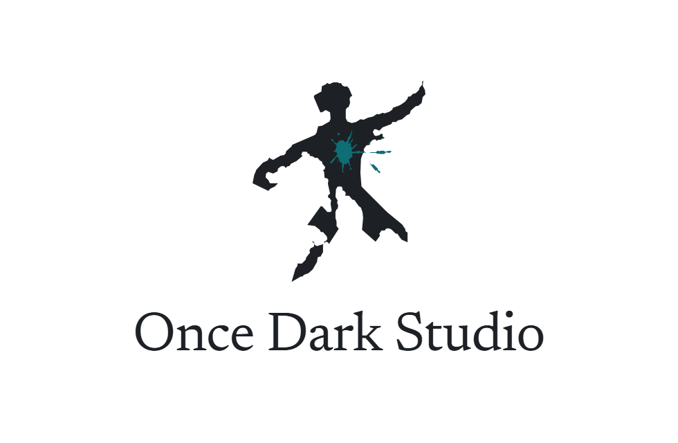
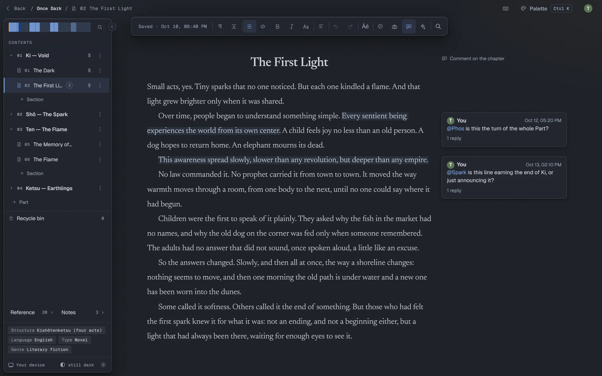

<p align="center">
  <picture>
    <source media="(prefers-color-scheme: dark)" srcset="docs/brand/lockup-stacked-dark.png">
    
  </picture>
</p>

<p align="center">
  Free and open source, a project open to everyone, not for profit.
</p>

<p align="center">
  <a href="https://github.com/perseomazzoni/phospheare/actions/workflows/ci.yml"></a>
  <a href="LICENSE"></a>
</p>

<p align="center">
  <a href="#quickstart-for-everyone">Quickstart</a> ·
  <a href="docs/install.md">Install guide</a>
</p>

**A dedicated writing environment for novelists.** Once Dark Studio brings
the essential tools for developing and managing a book into one cohesive
workspace: a purpose-built editor, project library, revision history,
reference sheets, annotations and optional AI-powered editorial assistance.

Designed for long-form writing, it combines a structured approach to manuscript
organization with a distraction-conscious editing experience. Typewriter and
focus modes, document snapshots, draft comparison, contextual comments and
flexible import and export options support the entire writing process, from
the start, through rewrites, to the final polish. The complete list of
features is in [docs/features.md](docs/features.md).

**Local-first by design.** It runs entirely on the writer's computer and
presents its interface through a web browser. It's been developed on a simple
principle: ownership. The writer should always remain in control of their
work. No remote application server or third-party hosting is required for
ordinary use. Their books are not locked inside a proprietary database or tied
to a subscription service: they are standard, portable files that the writer
can inspect, back up, edit with other applications and move wherever they
choose. Their creative work belongs to them. The software exists to support
it, not to own it. Where each piece of data lives, and what can leave the
writer's computer, is in
[docs/architecture.md](docs/architecture.md#where-the-manuscript-lives-and-where-it-does-not),
in [part 6 of the install guide](docs/install.md#6-where-your-data-is) and in
the privacy notice in the app (`/privacy`). The assistant's providers, the
search engine among them, are in [docs/ai.md](docs/ai.md). The assistant
reads and comments, but it cannot change the writer's manuscript.

> **Alpha.** Once Dark Studio is pre-production and in active development.
> Features, interfaces and internal behaviour may change between releases. When
> you experiment with it, keep independent backups of any manuscripts and
> project files you cannot afford to lose.

<p align="center">
  <a href="docs/images/readme-workspace.webp"></a><br>
  <sub>Write with your book's structure in view.</sub>
</p>

## Quickstart, for everyone

You build Once Dark Studio from its source code, on your own computer. You
don't need to know how to program: it takes a few commands and a few clicks.

### 1. Install the tools

Install each tool with its default options.

| Tool    | Download                            | Notes                                                                                                                                                   |
| ------- | ----------------------------------- | ------------------------------------------------------------------------------------------------------------------------------------------------------- |
| Node.js | <https://nodejs.org/en/download>    | Choose the **LTS** version, 26 or newer. On Windows, leave "Automatically install the necessary tools" unticked. On a Mac, choose the `.pkg` installer. |
| Go      | <https://go.dev/dl/>                | Choose the newest version for your computer. On a Mac, choose the `.pkg` installer.                                                                     |
| Git     | <https://git-scm.com/downloads/win> | Windows only. It adds **Git Bash**, where you type the commands.                                                                                        |

### 2. Download the source code

1. Download [once-dark-studio-source.zip](https://github.com/perseomazzoni/phospheare/releases/latest/download/once-dark-studio-source.zip),
   the source code of the latest release.
2. Unzip it somewhere easy to find, such as Documents. You get a folder
   called `once-dark-studio`. If Windows puts it inside another folder, use
   the `once-dark-studio` folder: the one that holds `README.md`.

### 3. Open a terminal in that folder

- **Windows**: right-click inside the folder and choose **Open Git Bash
  here**. On Windows 11, choose **Show more options** first.
- **Mac**: open **Terminal**, type `cd` followed by a space, drag the folder
  onto the window and press Return.
- **Linux**: right-click inside the folder and choose **Open in Terminal**.

### 4. Build

Copy each command, paste it into the terminal and press Enter. Wait for it to
finish before you start the next one. In Git Bash, right-click and choose
**Paste**.

```bash
npm ci
```

```bash
npm run build
```

```bash
npm run notices
```

```bash
sh desktop/build.sh
```

Lines that start with `npm warn` are normal. The build is finished when it
shows `build.sh: archives in`.

### 5. Start

1. Inside the folder, open `desktop/dist`. Unzip the archive for your
   computer:
   - Windows: `…-windows-amd64.zip`
   - Mac: `…-darwin-arm64.tar.gz` for an Apple chip, or
     `…-darwin-amd64.tar.gz` for Intel
   - Linux: `…-linux-amd64.tar.gz`, or `…-linux-arm64.tar.gz` on ARM
2. Move the folder that you get to where you want to keep it, and rename it
   if you like. On Windows, use `Documents`. On a Mac, use `Applications`. On
   Linux, use your home folder.
3. Inside that folder, double-click `once-dark-studio-desktop`. On Linux, run
   `./once-dark-studio-desktop` in a terminal in that folder.

Your browser opens Once Dark Studio. To set it up, follow the
[install guide](docs/install.md#2-your-first-book-without-an-account).

Next time, just start the program again. To get a new version, do steps 2 to
5 again. Your books stay where they are.

## For developers

Phospheare is the project's internal name: the repository, the code and the
developer documentation use it. Once Dark Studio is the product's name, the
one in the interface; it lives in [`product.json`](product.json).

[CONTRIBUTING.md](CONTRIBUTING.md) explains how to set up, run, test and
build the project, and holds the repository map.
[docs/architecture.md](docs/architecture.md) describes how the pieces fit
together. CI runs the typecheck, lint, the unit suite with coverage, the Go
tests with the race detector and the Playwright runs in real browsers on
every pull request and on `main`.

## Built with AI

I want to be upfront about how this project is made. I wanted to explore the
capabilities of modern AI development tools and discover how far I could take
a software project without writing the code myself. Honestly, it has been a
good experience. The ideas, the design decisions, the testing and the
debugging are mine; AI agents write the code.

Just as important is a big thank-you. None of this would exist without the
open-source work it stands on, built by many people over many years: React,
Vite and Go; markdown-it, pdfmake, fflate and fontkit; and, on the AI side,
Ollama and OpenRouter. Every dependency is listed, with its licence, in the
third-party notices that ship with the app (`/third-party-notices.txt`) and
with every release.

## Skills out of the box

I've built a minimal set of skills, and I configured Claude (other agents are
supported too) to use them and the documentation available in the repo. It is
a subset of what I use for actual development, made with anyone who wants to
start contributing in mind. If you want, you can start with them, and use them
in whatever workflow or tools you rely on in your day-to-day development. You
can also suggest new setups for the project. The idea is to provide a "base" for
everyone, not a full-fledged, fixed environment you must use in order to
contribute to the project. Let's say you find some basic tools out of the box,
but you still have your personal toolbox, and you can use it. Contributions
made without AI are just as welcome.

In short:

- [AGENTS.md](AGENTS.md) is where every agent starts: what the project is,
  how to work here, the commands and the list of skills.
  [CLAUDE.md](CLAUDE.md) imports it.
- The skills are in [.claude/skills/](.claude/skills/), from `suggest`
  before a change to `verify` and `rules-review` after it. OpenCode runs them
  through [.opencode/commands/](.opencode/commands/).
- [.claude/settings.json](.claude/settings.json) lets the agent run the
  tests and builds, asks you before every commit, push or pull request, keeps
  `.env` unread and formats each edited file with Prettier.

## The logo

I designed the product's mark, which I call "The Same Spark", with a little
help from generative AI. If you are curious how it came together, the emblem,
the whole mark family, the favicon, the lockups and the design study behind
them are all in [docs/brand/](docs/brand/).

## Why this project

I've been writing code since 1997. But I also like art in all its forms: the
things that human hands and the human mind can make. I also enjoy writing,
and I couldn't find any software that did things the way I wanted them done.
So I decided to create it myself, at first just for me. But then I wondered:
why not make it available to everyone?

I put a lot of effort into building a product identity around "bringing light
where there was dark". The light of knowledge, the light of empathy. The light
of Life, with its good and its bad, but with one main point: we're all sharing
this planet, so let's make the best of it. Let's be one more person who
reduces the pain in the world. So where do great stories come from? They form
in darkness, then come to light. Once dark.

With this project, I'm bringing together everything I have: rationality,
technical skills, curiosity, empathy, vision and care.

It's not perfect, not even close, but I'll work on fixes and improvements over
time. I hope you find it useful.

— [Perseo Mazzoni](https://www.linkedin.com/in/perseo-mazzoni/)

## Bugs and contributions

Report bugs and regressions as
[GitHub issues](https://github.com/perseomazzoni/phospheare/issues), with
the version, your browser, the storage mode and the steps to reproduce the
problem. Pull requests are welcome, provided that they pass the gates in
[CONTRIBUTING.md](CONTRIBUTING.md). Report security problems privately, as
[SECURITY.md](SECURITY.md) describes.

### Send the log with a bug report

Each part of Once Dark Studio keeps a log of what it did in the last 14
days, to help find the cause of a problem. Before it writes a line, it
removes the names, email and network addresses that it recognizes. Nothing
sends the log by itself: you decide whether to send it.

- **In the app:** Settings → About → **Show the log**, then **Download the
  log**.
- **In the desktop program:** on its setup page, Other settings → Log →
  **Show the files**, or **Show the log files** in the tray menu. Send
  `desktop.log` and `identity.log`. If the program stopped with a crash,
  start it again before you send them: the next start removes the personal
  values from the crash, writes it into `desktop.log` and empties
  `crash.txt`.

**Before you send the log, read it yourself.** You must check that it holds
nothing you do not want to make public. The app removes what it knows to be
personal, but only you know what is private to you.

Attach the files to the GitHub issue. Each line carries your account id, a
random code with no name in it. If you prefer not to post the log in public,
email it to [contact@oncedark.studio](mailto:contact@oncedark.studio) with the
issue number.

## Licence

Phospheare is free software, released under the
[GNU Affero General Public License, version 3](LICENSE) or any later version.
It is free of charge and not for profit. If you modify it and let other
people use your version over a network, the AGPL requires you to offer those
users the source code of the version they are using. The open-source
components it depends on keep their own, permissive licences, listed in the
third-party notices; the bundled fonts are under the SIL Open Font License.

### No warranty

Phospheare is a personal project, made in the author's free time, with no
company behind it. It comes as it is, with no warranty, to the extent
permitted by law: see sections 15 and 16 of the [licence](LICENSE), and "Use
and licence" in the app. The author does not see or control what an AI model
writes; check it before you use it.
